---
tags:
  - scrolllab
  - reference-analysis
  - apex
aliases:
  - Apex analysis
  - analyze apex
analyzed: 2026-10-11
source: https://www.esrbespoke.au/
beats: 22
---

# Apex — análisis de referencia

Generado por `scripts/analyze-reference.mjs` el 2026-10-11.

**URL:** https://www.esrbespoke.au/  
**SKU sugerido:** `apex`  
**Title:** ESR  
**Beats:** 22 (muestreo adaptativo; solo cambios) · maxScroll=6870px

## Librerías detectadas

- `lenis`
- `next`

### Scripts (muestra)

- `https://www.esrbespoke.au/_next/static/chunks/polyfills-42372ed130431b0a.js`
- `https://www.esrbespoke.au/_next/static/chunks/webpack-c4c67869b2eaf6be.js`
- `https://www.esrbespoke.au/_next/static/chunks/framework-64ad27b21261a9ce.js`
- `https://www.esrbespoke.au/_next/static/chunks/main-4b423ec82b590a3f.js`
- `https://www.esrbespoke.au/_next/static/chunks/pages/_app-73de1ae2e4fdf2b5.js`
- `https://www.esrbespoke.au/_next/static/chunks/94726e6d-ea109d70b133db93.js`
- `https://www.esrbespoke.au/_next/static/chunks/457-97f8d33e3bf8c638.js`
- `https://www.esrbespoke.au/_next/static/chunks/792-c0bbf8f9d8820cfa.js`
- `https://www.esrbespoke.au/_next/static/chunks/pages/%5B%5B...slug%5D%5D-18da56d929bfa1ff.js`
- `https://www.esrbespoke.au/_next/static/9ix10enmKtr8fTCSsfGYS/_buildManifest.js`
- `https://www.esrbespoke.au/_next/static/9ix10enmKtr8fTCSsfGYS/_ssgManifest.js`

### Fonts cargadas

- __bodyFont_0f148b
- __headingFont_a39ca7

`html.class`: `__variable_0f148b __variable_a39ca7 lenis lenis-smooth`

## Técnicas inferidas

- Smooth scroll: Lenis
- Sticky/fixed nodes: Open menu, div, curtain
- Beats significativos: 22 (solo cambios de firma)

## Capas Framer (`data-framer-name`)

- (no Framer names)

## Headings

| Tag | Texto | Font | Size |
|---|---|---|---|
| H1 | Exceptional is our standard | __bodyFont_0f148b | 62px |
| H2 | ESR is recognised as an official Porsche Certified Collision | __bodyFont_0f148b | 40px |
| H2 | At ESR, we offer a complete end-to-end service experience fo | __bodyFont_0f148b | 40px |

## Beats (fondo / figura / texto)

### Beat 0 — 0% (y=0)

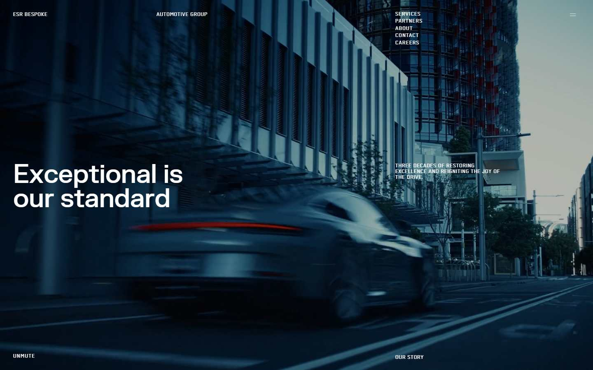

**Cambios vs anterior**
- beat inicial

**Fondo:** `rgb(255, 255, 255)`

**Figuras / media**
- **div** (div) opacity=1 · `matrix(1, 0, 0, 1, 0, 0)`
- **div** (div) opacity=1 · `matrix(1, 0, 0, 1, 0, 0)`
- **div** (div) opacity=1 · `matrix(1, 0, 0, 1, 0, 0)`
- **video** (video) opacity=0.8
- **video** (video) opacity=1
- **g** (g) opacity=1 · `matrix(1, 0, 0, 1, 0, 170)`

**Texto visible**
- “Exceptional is our standard” · 62px __bodyFont_0f148b
- “Contact” · 14px __headingFont_a39ca7
- “(02) 9735 1111enquiries@esrbespoke.au8am – 5pm Monday to Friday” · 14px __headingFont_a39ca7
- “ESR HQ” · 14px __headingFont_a39ca7
- “419-431 Canterbury Road, Campsie NSW 2194Hq@esrbespoke.au” · 14px __headingFont_a39ca7
- “ESR Bespoke Studio” · 14px __headingFont_a39ca7

**Sticky:** Open menu, div, div, div, curtain

### Beat 1 — 3% (y=215)

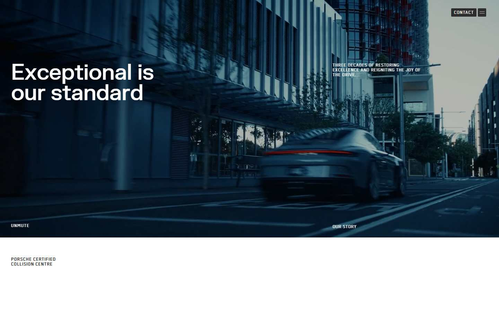

**Cambios vs anterior**
- figura mueve: div opacity 1→1 t=matrix(1, 0, 0, 1, 0, 64.5)
- figura mueve: video opacity 1→0.8
- texto aparece: “Porsche Certified”
- texto aparece: “Collision Centre”

**Fondo:** `rgb(255, 255, 255)`

**Figuras / media**
- **div** (div) opacity=1 · `matrix(1, 0, 0, 1, 0, 64.5)`
- **div** (div) opacity=1 · `matrix(1, 0, 0, 1, 0, 0)`
- **div** (div) opacity=1 · `matrix(1, 0, 0, 1, 0, 0)`
- **video** (video) opacity=0.8
- **video** (video) opacity=1
- **g** (g) opacity=1 · `matrix(1, 0, 0, 1, 0, 170)`

**Texto visible**
- “Exceptional is our standard” · 62px __bodyFont_0f148b
- “Porsche Certified” · 14px __headingFont_a39ca7
- “Collision Centre” · 14px __headingFont_a39ca7
- “Contact” · 14px __headingFont_a39ca7
- “(02) 9735 1111enquiries@esrbespoke.au8am – 5pm Monday to Friday” · 14px __headingFont_a39ca7
- “ESR HQ” · 14px __headingFont_a39ca7

**Sticky:** Open menu, div, div, div, curtain

### Beat 2 — 6% (y=429)

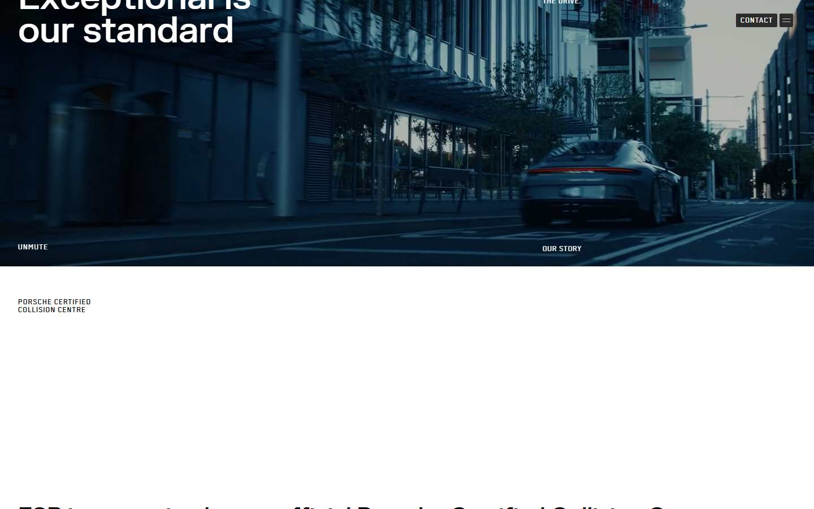

**Cambios vs anterior**
- figura mueve: div opacity 1→1 t=matrix(1, 0, 0, 1, 0, 128.7)
- figura mueve: video opacity 1→0.8

**Fondo:** `rgb(255, 255, 255)`

**Figuras / media**
- **div** (div) opacity=1 · `matrix(1, 0, 0, 1, 0, 128.7)`
- **div** (div) opacity=1 · `matrix(1, 0, 0, 1, 0, 0)`
- **div** (div) opacity=1 · `matrix(1, 0, 0, 1, 0, 0)`
- **video** (video) opacity=0.8
- **video** (video) opacity=1
- **g** (g) opacity=1 · `matrix(1, 0, 0, 1, 0, 170)`

**Texto visible**
- “Exceptional is our standard” · 62px __bodyFont_0f148b
- “Porsche Certified” · 14px __headingFont_a39ca7
- “Collision Centre” · 14px __headingFont_a39ca7
- “Contact” · 14px __headingFont_a39ca7
- “(02) 9735 1111enquiries@esrbespoke.au8am – 5pm Monday to Friday” · 14px __headingFont_a39ca7
- “ESR HQ” · 14px __headingFont_a39ca7

**Sticky:** Open menu, div, div, div, curtain

### Beat 3 — 9% (y=644)

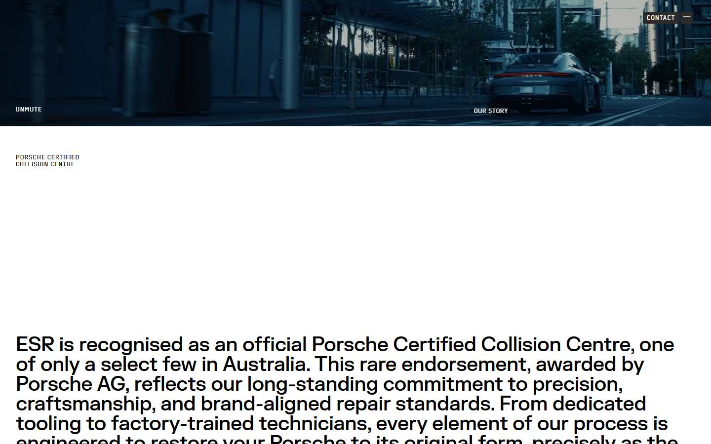

**Cambios vs anterior**
- figura mueve: div opacity 1→1 t=matrix(1, 0, 0, 1, 0, 193.2)
- figura mueve: video opacity 1→0.8
- texto sale: “Exceptional is our standard”

**Fondo:** `rgb(255, 255, 255)`

**Figuras / media**
- **div** (div) opacity=1 · `matrix(1, 0, 0, 1, 0, 193.2)`
- **div** (div) opacity=1 · `matrix(1, 0, 0, 1, 0, 0)`
- **div** (div) opacity=1 · `matrix(1, 0, 0, 1, 0, 0)`
- **video** (video) opacity=0.8
- **video** (video) opacity=1
- **g** (g) opacity=1 · `matrix(1, 0, 0, 1, 0, 170)`

**Texto visible**
- “Porsche Certified” · 14px __headingFont_a39ca7
- “Collision Centre” · 14px __headingFont_a39ca7
- “Contact” · 14px __headingFont_a39ca7
- “(02) 9735 1111enquiries@esrbespoke.au8am – 5pm Monday to Friday” · 14px __headingFont_a39ca7
- “ESR HQ” · 14px __headingFont_a39ca7
- “419-431 Canterbury Road, Campsie NSW 2194Hq@esrbespoke.au” · 14px __headingFont_a39ca7

**Sticky:** Open menu, div, div, div, curtain

### Beat 4 — 13% (y=859)

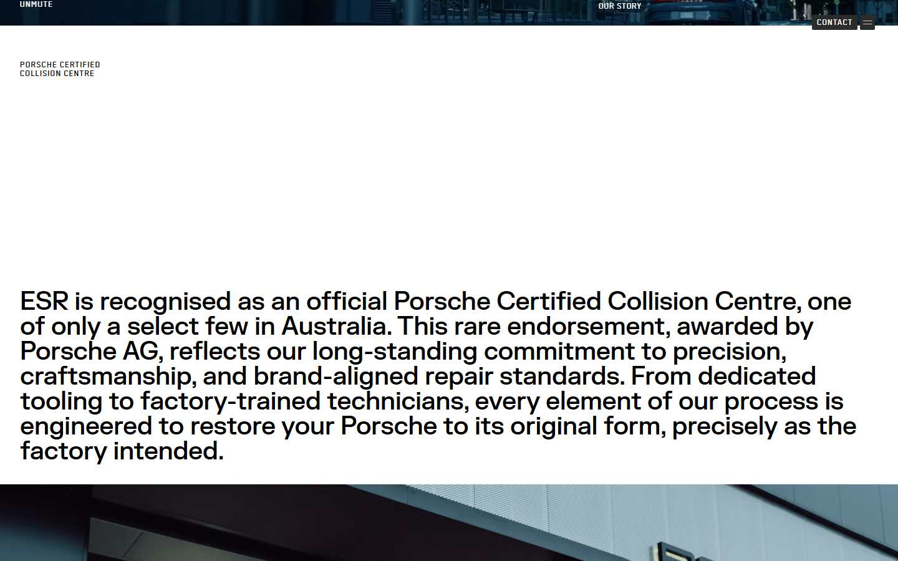

**Cambios vs anterior**
- figura entra: canvas (canvas)
- figura mueve: div opacity 1→1 t=matrix(1, 0, 0, 1, 0, 257.7)
- figura mueve: video opacity 1→0.8

**Fondo:** `rgb(255, 255, 255)`

**Figuras / media**
- **canvas** (canvas) opacity=1
- **div** (div) opacity=1 · `matrix(1, 0, 0, 1, 0, 257.7)`
- **div** (div) opacity=1 · `matrix(1, 0, 0, 1, 0, 0)`
- **div** (div) opacity=1 · `matrix(1, 0, 0, 1, 0, 0)`
- **video** (video) opacity=0.8
- **video** (video) opacity=1

**Texto visible**
- “Porsche Certified” · 14px __headingFont_a39ca7
- “Collision Centre” · 14px __headingFont_a39ca7
- “Contact” · 14px __headingFont_a39ca7
- “(02) 9735 1111enquiries@esrbespoke.au8am – 5pm Monday to Friday” · 14px __headingFont_a39ca7
- “ESR HQ” · 14px __headingFont_a39ca7
- “419-431 Canterbury Road, Campsie NSW 2194Hq@esrbespoke.au” · 14px __headingFont_a39ca7

**Sticky:** Open menu, div, div, div, curtain

### Beat 5 — 16% (y=1073)

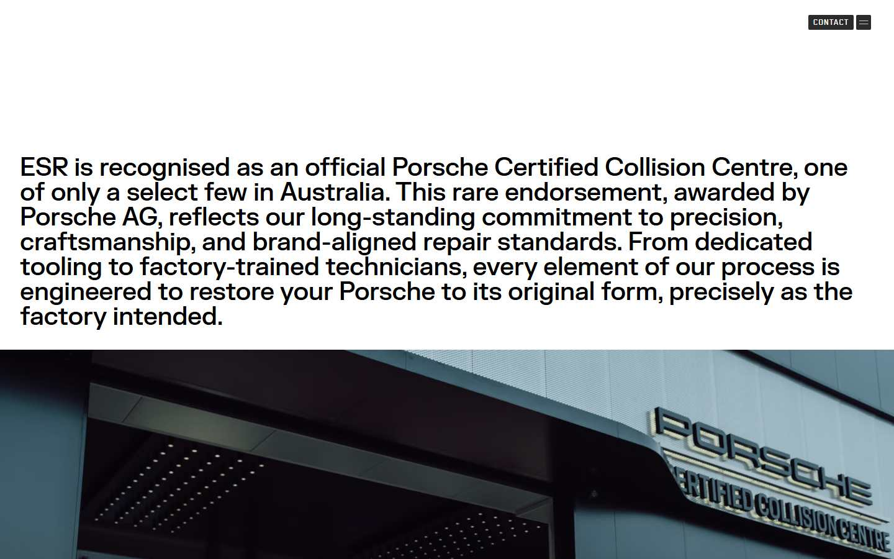

**Cambios vs anterior**
- figura mueve: div opacity 1→1 t=matrix(1, 0, 0, 1, 0, 321.9)
- figura mueve: video opacity 1→0.8
- texto sale: “Porsche Certified”
- texto sale: “Collision Centre”

**Fondo:** `rgb(255, 255, 255)`

**Figuras / media**
- **div** (div) opacity=1 · `matrix(1, 0, 0, 1, 0, 321.9)`
- **div** (div) opacity=1 · `matrix(1, 0, 0, 1, 0, 0)`
- **div** (div) opacity=1 · `matrix(1, 0, 0, 1, 0, 0)`
- **video** (video) opacity=0.8
- **video** (video) opacity=1
- **canvas** (canvas) opacity=1

**Texto visible**
- “Contact” · 14px __headingFont_a39ca7
- “(02) 9735 1111enquiries@esrbespoke.au8am – 5pm Monday to Friday” · 14px __headingFont_a39ca7
- “ESR HQ” · 14px __headingFont_a39ca7
- “419-431 Canterbury Road, Campsie NSW 2194Hq@esrbespoke.au” · 14px __headingFont_a39ca7
- “ESR Bespoke Studio” · 14px __headingFont_a39ca7
- “16-20 Birmingham Street, Alexandria NSW 2015Studio@esrbespoke.au” · 14px __headingFont_a39ca7

**Sticky:** Open menu, div, div, div, curtain

### Beat 6 — 19% (y=1288)

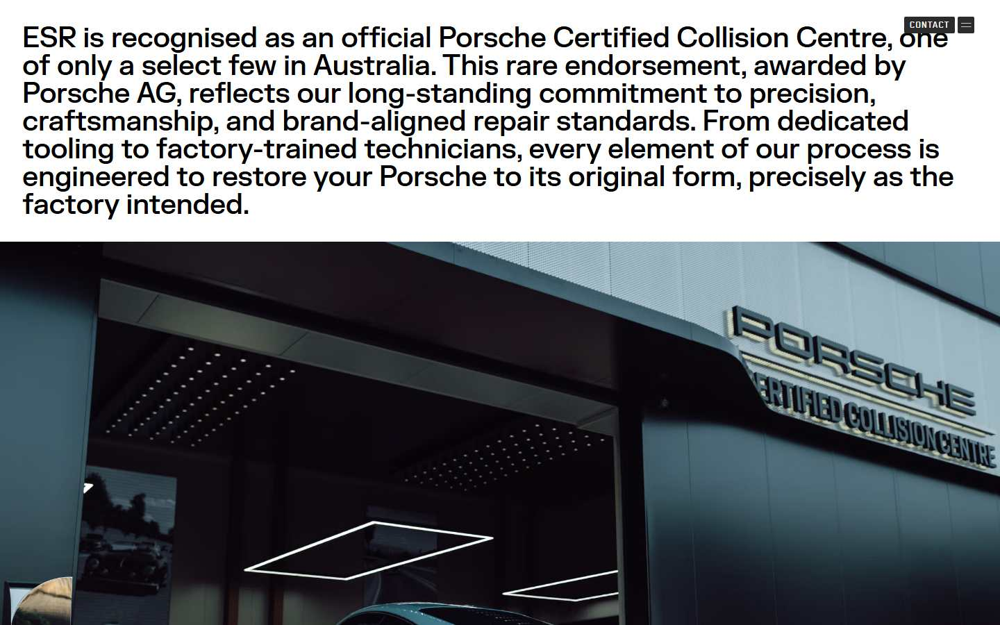

**Cambios vs anterior**
- cambio sutil de composición

**Fondo:** `rgb(255, 255, 255)`

**Figuras / media**
- **canvas** (canvas) opacity=1
- **g** (g) opacity=1 · `matrix(1, 0, 0, 1, 0, 170)`
- **g** (g) opacity=1 · `matrix(1, 0, 0, 1, 0, 170)`
- **g** (g) opacity=1 · `matrix(1, 0, 0, 1, 0, 170)`

**Texto visible**
- “Contact” · 14px __headingFont_a39ca7
- “(02) 9735 1111enquiries@esrbespoke.au8am – 5pm Monday to Friday” · 14px __headingFont_a39ca7
- “ESR HQ” · 14px __headingFont_a39ca7
- “419-431 Canterbury Road, Campsie NSW 2194Hq@esrbespoke.au” · 14px __headingFont_a39ca7
- “ESR Bespoke Studio” · 14px __headingFont_a39ca7
- “16-20 Birmingham Street, Alexandria NSW 2015Studio@esrbespoke.au” · 14px __headingFont_a39ca7

**Sticky:** Open menu, div, div, div, curtain

### Beat 7 — 25% (y=1718)

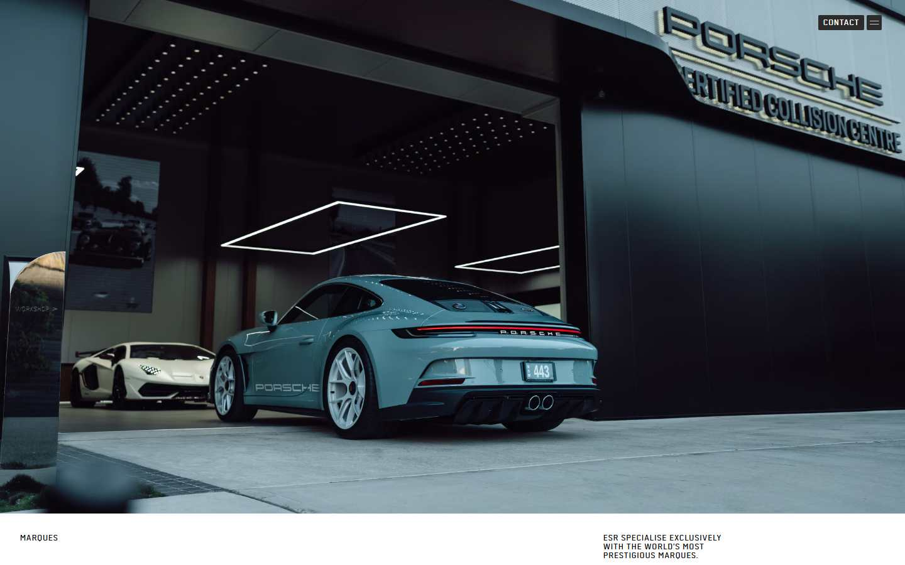

**Cambios vs anterior**
- figura entra: div (div)
- texto aparece: “ESR specialise exclusively with the world’s most p”

**Fondo:** `rgb(255, 255, 255)`

**Figuras / media**
- **canvas** (canvas) opacity=1
- **div** (div) opacity=1 · `matrix(1, 0, 0, 1, 0, 0)`
- **g** (g) opacity=1 · `matrix(1, 0, 0, 1, 0, 170)`
- **g** (g) opacity=1 · `matrix(1, 0, 0, 1, 0, 170)`
- **g** (g) opacity=1 · `matrix(1, 0, 0, 1, 0, 170)`

**Texto visible**
- “ESR specialise exclusively with the world’s most prestigious marques.” · 14px __headingFont_a39ca7
- “Contact” · 14px __headingFont_a39ca7
- “(02) 9735 1111enquiries@esrbespoke.au8am – 5pm Monday to Friday” · 14px __headingFont_a39ca7
- “ESR HQ” · 14px __headingFont_a39ca7
- “419-431 Canterbury Road, Campsie NSW 2194Hq@esrbespoke.au” · 14px __headingFont_a39ca7
- “ESR Bespoke Studio” · 14px __headingFont_a39ca7

**Sticky:** Open menu, div, div, div, curtain

### Beat 8 — 31% (y=2147)

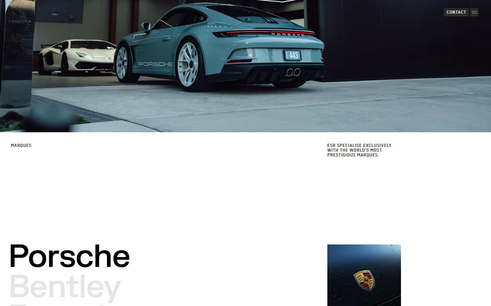

**Cambios vs anterior**
- figura entra: img (img)
- figura entra: img (img)
- figura entra: img (img)
- figura entra: img (img)
- figura entra: img (img)
- figura entra: img (img)

**Fondo:** `rgb(255, 255, 255)`

**Figuras / media**
- **canvas** (canvas) opacity=1
- **div** (div) opacity=1 · `matrix(1, 0, 0, 1, 0, 0)`
- **canvas** (canvas) opacity=1
- **img** (img) opacity=1
- **canvas** (canvas) opacity=1
- **img** (img) opacity=1

**Texto visible**
- “ESR specialise exclusively with the world’s most prestigious marques.” · 14px __headingFont_a39ca7
- “Contact” · 14px __headingFont_a39ca7
- “(02) 9735 1111enquiries@esrbespoke.au8am – 5pm Monday to Friday” · 14px __headingFont_a39ca7
- “ESR HQ” · 14px __headingFont_a39ca7
- “419-431 Canterbury Road, Campsie NSW 2194Hq@esrbespoke.au” · 14px __headingFont_a39ca7
- “ESR Bespoke Studio” · 14px __headingFont_a39ca7

**Sticky:** Open menu, div, div, div, div, curtain

### Beat 9 — 38% (y=2576)

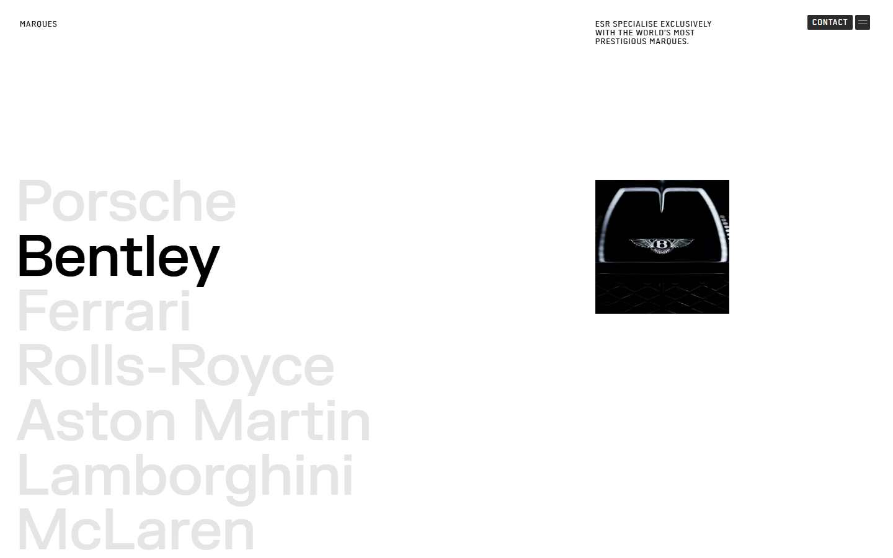

**Cambios vs anterior**
- cambio sutil de composición

**Fondo:** `rgb(255, 255, 255)`

**Figuras / media**
- **div** (div) opacity=1 · `matrix(1, 0, 0, 1, 0, 0)`
- **canvas** (canvas) opacity=1
- **img** (img) opacity=1
- **canvas** (canvas) opacity=1
- **img** (img) opacity=1
- **canvas** (canvas) opacity=1

**Texto visible**
- “ESR specialise exclusively with the world’s most prestigious marques.” · 14px __headingFont_a39ca7
- “Contact” · 14px __headingFont_a39ca7
- “(02) 9735 1111enquiries@esrbespoke.au8am – 5pm Monday to Friday” · 14px __headingFont_a39ca7
- “ESR HQ” · 14px __headingFont_a39ca7
- “419-431 Canterbury Road, Campsie NSW 2194Hq@esrbespoke.au” · 14px __headingFont_a39ca7
- “ESR Bespoke Studio” · 14px __headingFont_a39ca7

**Sticky:** Open menu, div, div, div, div, div, curtain

### Beat 10 — 53% (y=3650)

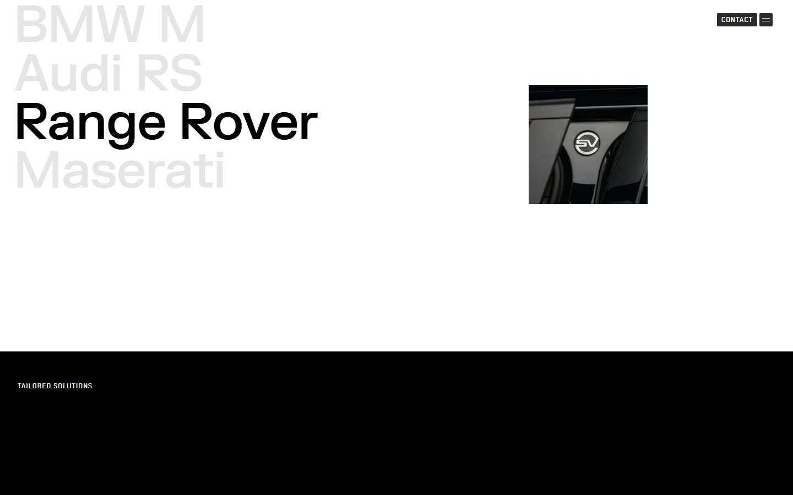

**Cambios vs anterior**
- texto sale: “ESR specialise exclusively with the world’s most p”

**Fondo:** `rgb(255, 255, 255)`

**Figuras / media**
- **canvas** (canvas) opacity=1
- **img** (img) opacity=1
- **canvas** (canvas) opacity=1
- **img** (img) opacity=1
- **canvas** (canvas) opacity=1
- **img** (img) opacity=1

**Texto visible**
- “Contact” · 14px __headingFont_a39ca7
- “(02) 9735 1111enquiries@esrbespoke.au8am – 5pm Monday to Friday” · 14px __headingFont_a39ca7
- “ESR HQ” · 14px __headingFont_a39ca7
- “419-431 Canterbury Road, Campsie NSW 2194Hq@esrbespoke.au” · 14px __headingFont_a39ca7
- “ESR Bespoke Studio” · 14px __headingFont_a39ca7
- “16-20 Birmingham Street, Alexandria NSW 2015Studio@esrbespoke.au” · 14px __headingFont_a39ca7

**Sticky:** Open menu, div, div, div, div, curtain

### Beat 11 — 59% (y=4079)

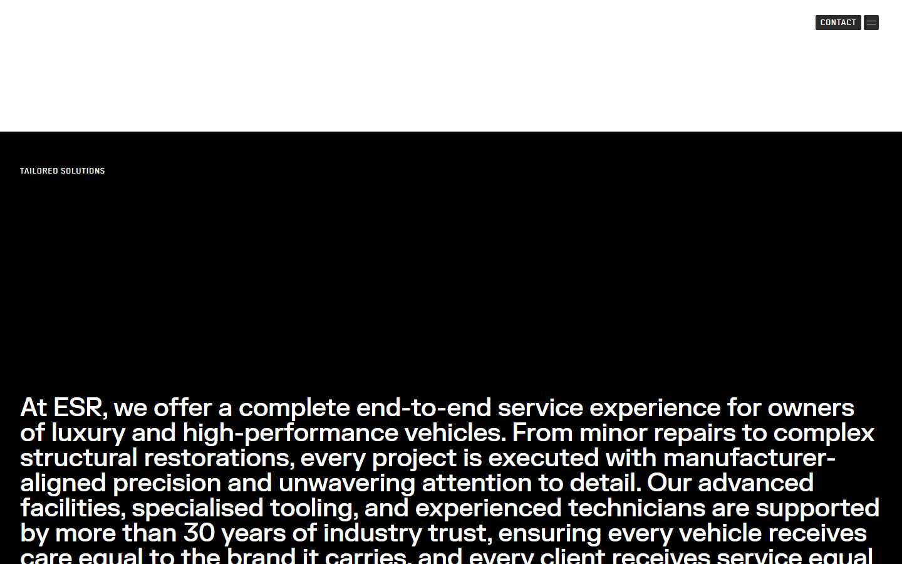

**Cambios vs anterior**
- figura entra: g (g)
- figura entra: g (g)
- figura entra: g (g)

**Fondo:** `rgb(255, 255, 255)`

**Figuras / media**
- **g** (g) opacity=1 · `matrix(1, 0, 0, 1, 0, 170)`
- **g** (g) opacity=1 · `matrix(1, 0, 0, 1, 0, 170)`
- **g** (g) opacity=1 · `matrix(1, 0, 0, 1, 0, 170)`

**Texto visible**
- “Contact” · 14px __headingFont_a39ca7
- “(02) 9735 1111enquiries@esrbespoke.au8am – 5pm Monday to Friday” · 14px __headingFont_a39ca7
- “ESR HQ” · 14px __headingFont_a39ca7
- “419-431 Canterbury Road, Campsie NSW 2194Hq@esrbespoke.au” · 14px __headingFont_a39ca7
- “ESR Bespoke Studio” · 14px __headingFont_a39ca7
- “16-20 Birmingham Street, Alexandria NSW 2015Studio@esrbespoke.au” · 14px __headingFont_a39ca7

**Sticky:** Open menu, div, div, div, curtain

### Beat 12 — 66% (y=4508)

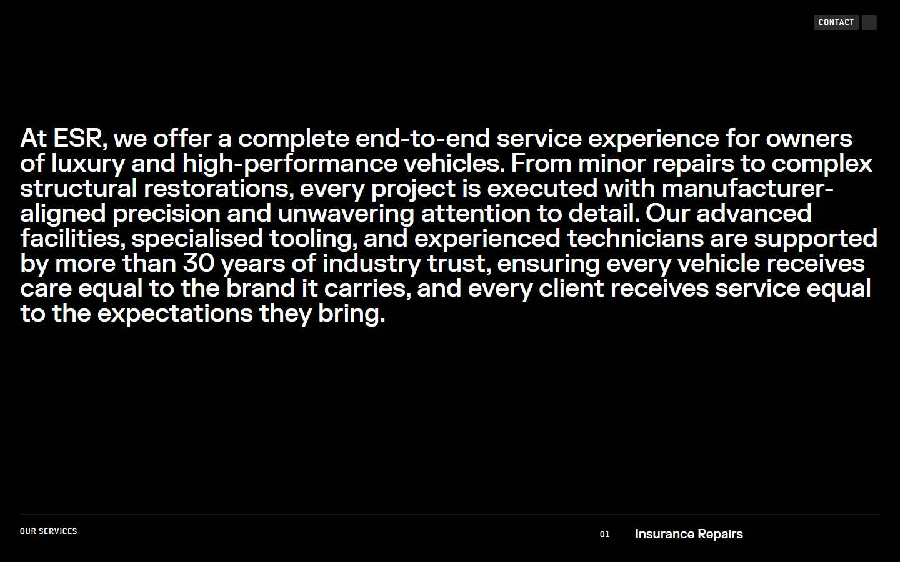

**Cambios vs anterior**
- texto aparece: “Insurance Repairs”

**Fondo:** `rgb(255, 255, 255)`

**Figuras / media**
- **g** (g) opacity=1 · `matrix(1, 0, 0, 1, 0, 170)`
- **g** (g) opacity=1 · `matrix(1, 0, 0, 1, 0, 170)`
- **g** (g) opacity=1 · `matrix(1, 0, 0, 1, 0, 170)`

**Texto visible**
- “Insurance Repairs” · 20px __bodyFont_0f148b
- “Contact” · 14px __headingFont_a39ca7
- “(02) 9735 1111enquiries@esrbespoke.au8am – 5pm Monday to Friday” · 14px __headingFont_a39ca7
- “ESR HQ” · 14px __headingFont_a39ca7
- “419-431 Canterbury Road, Campsie NSW 2194Hq@esrbespoke.au” · 14px __headingFont_a39ca7
- “ESR Bespoke Studio” · 14px __headingFont_a39ca7

**Sticky:** Open menu, div, div, div, curtain

### Beat 13 — 69% (y=4723)

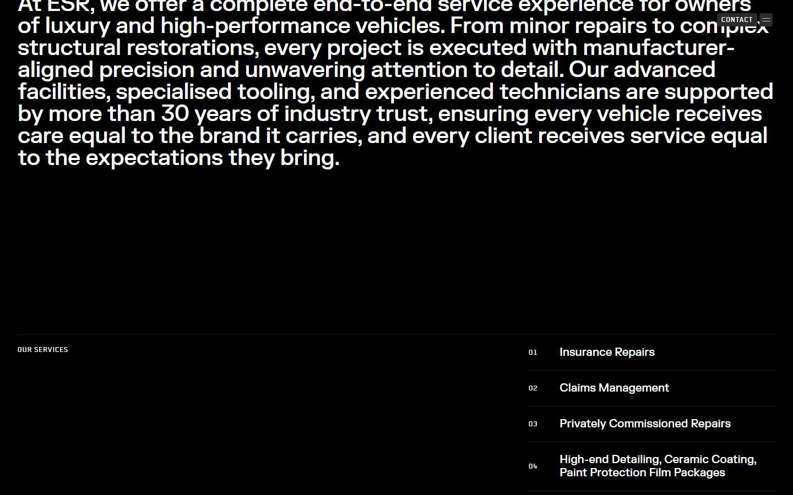

**Cambios vs anterior**
- texto aparece: “Claims Management”
- texto aparece: “Privately Commissioned Repairs”
- texto aparece: “High-end Detailing, Ceramic Coating, Paint Protect”

**Fondo:** `rgb(255, 255, 255)`

**Figuras / media**
- **g** (g) opacity=1 · `matrix(1, 0, 0, 1, 0, 170)`
- **g** (g) opacity=1 · `matrix(1, 0, 0, 1, 0, 170)`
- **g** (g) opacity=1 · `matrix(1, 0, 0, 1, 0, 170)`

**Texto visible**
- “Insurance Repairs” · 20px __bodyFont_0f148b
- “Claims Management” · 20px __bodyFont_0f148b
- “Privately Commissioned Repairs” · 20px __bodyFont_0f148b
- “High-end Detailing, Ceramic Coating, Paint Protection Film Packages” · 20px __bodyFont_0f148b
- “Contact” · 14px __headingFont_a39ca7
- “(02) 9735 1111enquiries@esrbespoke.au8am – 5pm Monday to Friday” · 14px __headingFont_a39ca7

**Sticky:** Open menu, div, div, div, curtain

### Beat 14 — 72% (y=4938)

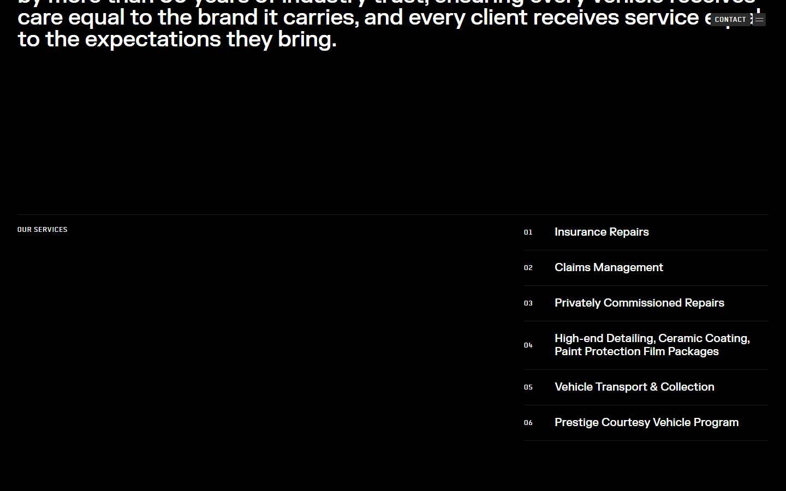

**Cambios vs anterior**
- texto aparece: “Vehicle Transport & Collection”
- texto aparece: “Prestige Courtesy Vehicle Program”

**Fondo:** `rgb(255, 255, 255)`

**Figuras / media**
- **g** (g) opacity=1 · `matrix(1, 0, 0, 1, 0, 170)`
- **g** (g) opacity=1 · `matrix(1, 0, 0, 1, 0, 170)`
- **g** (g) opacity=1 · `matrix(1, 0, 0, 1, 0, 170)`

**Texto visible**
- “Insurance Repairs” · 20px __bodyFont_0f148b
- “Claims Management” · 20px __bodyFont_0f148b
- “Privately Commissioned Repairs” · 20px __bodyFont_0f148b
- “High-end Detailing, Ceramic Coating, Paint Protection Film Packages” · 20px __bodyFont_0f148b
- “Vehicle Transport & Collection” · 20px __bodyFont_0f148b
- “Prestige Courtesy Vehicle Program” · 20px __bodyFont_0f148b

**Sticky:** Open menu, div, div, div, curtain

### Beat 15 — 78% (y=5367)

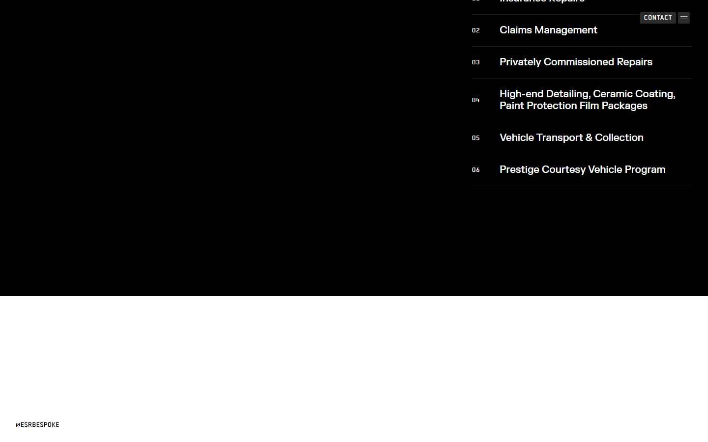

**Cambios vs anterior**
- texto sale: “Insurance Repairs”

**Fondo:** `rgb(255, 255, 255)`

**Figuras / media**
- **g** (g) opacity=1 · `matrix(1, 0, 0, 1, 0, 170)`
- **g** (g) opacity=1 · `matrix(1, 0, 0, 1, 0, 170)`
- **g** (g) opacity=1 · `matrix(1, 0, 0, 1, 0, 170)`

**Texto visible**
- “Claims Management” · 20px __bodyFont_0f148b
- “Privately Commissioned Repairs” · 20px __bodyFont_0f148b
- “High-end Detailing, Ceramic Coating, Paint Protection Film Packages” · 20px __bodyFont_0f148b
- “Vehicle Transport & Collection” · 20px __bodyFont_0f148b
- “Prestige Courtesy Vehicle Program” · 20px __bodyFont_0f148b
- “Contact” · 14px __headingFont_a39ca7

**Sticky:** Open menu, div, div, div, curtain

### Beat 16 — 81% (y=5582)

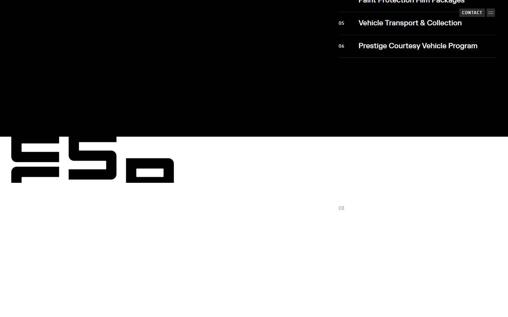

**Cambios vs anterior**
- figura mueve: g opacity 1→1 t=matrix(1, 0, 0, 1, 0, -18.6542)
- figura mueve: g opacity 1→1 t=matrix(1, 0, 0, 1, 0, 28.1977)
- figura mueve: g opacity 1→1 t=matrix(1, 0, 0, 1, 0, 99.8777)
- texto sale: “Claims Management”
- texto sale: “Privately Commissioned Repairs”
- texto sale: “High-end Detailing, Ceramic Coating, Paint Protect”

**Fondo:** `rgb(255, 255, 255)`

**Figuras / media**
- **g** (g) opacity=1 · `matrix(1, 0, 0, 1, 0, -18.6542)`
- **g** (g) opacity=1 · `matrix(1, 0, 0, 1, 0, 28.1977)`
- **g** (g) opacity=1 · `matrix(1, 0, 0, 1, 0, 99.8777)`

**Texto visible**
- “Vehicle Transport & Collection” · 20px __bodyFont_0f148b
- “Prestige Courtesy Vehicle Program” · 20px __bodyFont_0f148b
- “Contact” · 14px __headingFont_a39ca7
- “(02) 9735 1111enquiries@esrbespoke.au8am – 5pm Monday to Friday” · 14px __headingFont_a39ca7
- “ESR HQ” · 14px __headingFont_a39ca7
- “419-431 Canterbury Road, Campsie NSW 2194Hq@esrbespoke.au” · 14px __headingFont_a39ca7

**Sticky:** Open menu, div, div, div, curtain

### Beat 17 — 84% (y=5797)

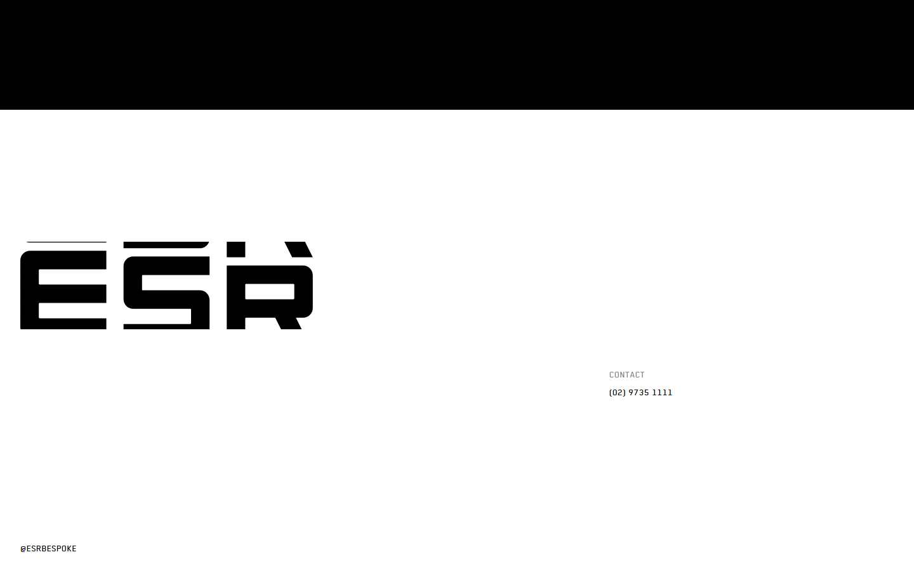

**Cambios vs anterior**
- sticky sale: Open menu
- figura mueve: g opacity 1→1 t=matrix(1, 0, 0, 1, 0, -94.6929)
- figura mueve: g opacity 1→1 t=matrix(1, 0, 0, 1, 0, -75.1424)
- figura mueve: g opacity 1→1 t=matrix(1, 0, 0, 1, 0, -87.0098)
- texto sale: “Vehicle Transport & Collection”
- texto sale: “Prestige Courtesy Vehicle Program”

**Fondo:** `rgb(255, 255, 255)`

**Figuras / media**
- **g** (g) opacity=1 · `matrix(1, 0, 0, 1, 0, -94.6929)`
- **g** (g) opacity=1 · `matrix(1, 0, 0, 1, 0, -75.1424)`
- **g** (g) opacity=1 · `matrix(1, 0, 0, 1, 0, -87.0098)`

**Texto visible**
- “Contact” · 14px __headingFont_a39ca7
- “(02) 9735 1111enquiries@esrbespoke.au8am – 5pm Monday to Friday” · 14px __headingFont_a39ca7
- “ESR HQ” · 14px __headingFont_a39ca7
- “419-431 Canterbury Road, Campsie NSW 2194Hq@esrbespoke.au” · 14px __headingFont_a39ca7
- “ESR Bespoke Studio” · 14px __headingFont_a39ca7
- “16-20 Birmingham Street, Alexandria NSW 2015Studio@esrbespoke.au” · 14px __headingFont_a39ca7

**Sticky:** div, div, curtain

### Beat 18 — 88% (y=5970)

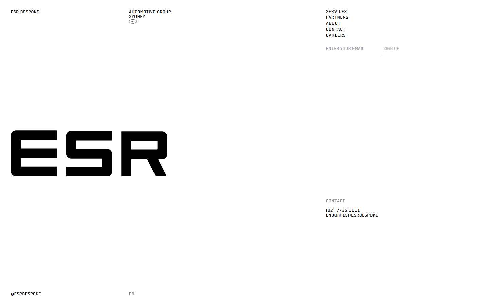

**Cambios vs anterior**
- figura mueve: g opacity 1→1 t=matrix(1, 0, 0, 1, 0, -105.102)
- figura mueve: g opacity 1→1 t=matrix(1, 0, 0, 1, 0, -104.185)
- figura mueve: g opacity 1→1 t=matrix(1, 0, 0, 1, 0, -102.509)

**Fondo:** `rgb(255, 255, 255)`

**Figuras / media**
- **g** (g) opacity=1 · `matrix(1, 0, 0, 1, 0, -105.102)`
- **g** (g) opacity=1 · `matrix(1, 0, 0, 1, 0, -104.185)`
- **g** (g) opacity=1 · `matrix(1, 0, 0, 1, 0, -102.509)`

**Texto visible**
- “Contact” · 14px __headingFont_a39ca7
- “(02) 9735 1111enquiries@esrbespoke.au8am – 5pm Monday to Friday” · 14px __headingFont_a39ca7
- “ESR HQ” · 14px __headingFont_a39ca7
- “419-431 Canterbury Road, Campsie NSW 2194Hq@esrbespoke.au” · 14px __headingFont_a39ca7
- “ESR Bespoke Studio” · 14px __headingFont_a39ca7
- “16-20 Birmingham Street, Alexandria NSW 2015Studio@esrbespoke.au” · 14px __headingFont_a39ca7

**Sticky:** div, div, curtain

### Beat 19 — 91% (y=5970)

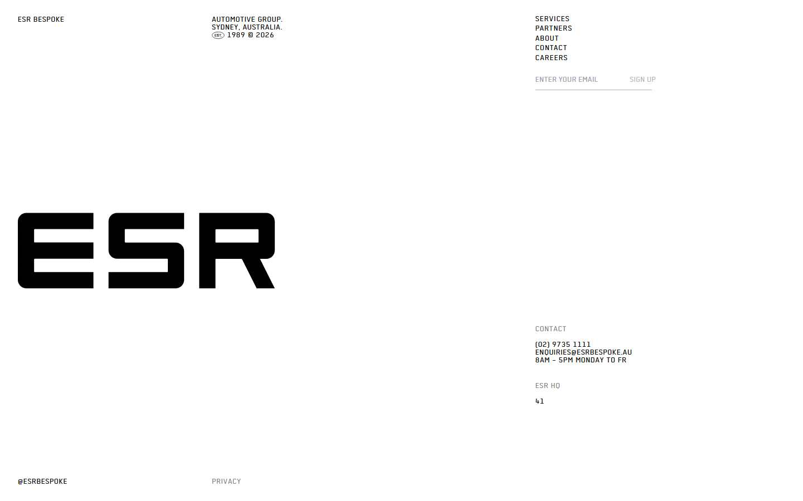

**Cambios vs anterior**
- figura mueve: g opacity 1→1 t=matrix(1, 0, 0, 1, 0, -105.975)
- figura mueve: g opacity 1→1 t=matrix(1, 0, 0, 1, 0, -105.921)
- figura mueve: g opacity 1→1 t=matrix(1, 0, 0, 1, 0, -105.808)

**Fondo:** `rgb(255, 255, 255)`

**Figuras / media**
- **g** (g) opacity=1 · `matrix(1, 0, 0, 1, 0, -105.975)`
- **g** (g) opacity=1 · `matrix(1, 0, 0, 1, 0, -105.921)`
- **g** (g) opacity=1 · `matrix(1, 0, 0, 1, 0, -105.808)`

**Texto visible**
- “Contact” · 14px __headingFont_a39ca7
- “(02) 9735 1111enquiries@esrbespoke.au8am – 5pm Monday to Friday” · 14px __headingFont_a39ca7
- “ESR HQ” · 14px __headingFont_a39ca7
- “419-431 Canterbury Road, Campsie NSW 2194Hq@esrbespoke.au” · 14px __headingFont_a39ca7
- “ESR Bespoke Studio” · 14px __headingFont_a39ca7
- “16-20 Birmingham Street, Alexandria NSW 2015Studio@esrbespoke.au” · 14px __headingFont_a39ca7

**Sticky:** div, div, curtain

### Beat 20 — 94% (y=5970)

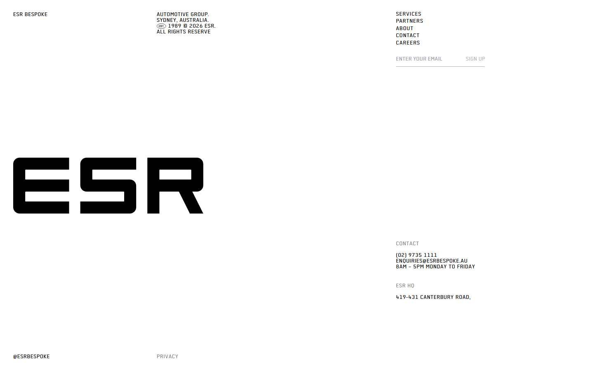

**Cambios vs anterior**
- figura mueve: g opacity 1→1 t=matrix(1, 0, 0, 1, 0, -106)
- figura mueve: g opacity 1→1 t=matrix(1, 0, 0, 1, 0, -106)
- figura mueve: g opacity 1→1 t=matrix(1, 0, 0, 1, 0, -106)

**Fondo:** `rgb(255, 255, 255)`

**Figuras / media**
- **g** (g) opacity=1 · `matrix(1, 0, 0, 1, 0, -106)`
- **g** (g) opacity=1 · `matrix(1, 0, 0, 1, 0, -106)`
- **g** (g) opacity=1 · `matrix(1, 0, 0, 1, 0, -106)`

**Texto visible**
- “Contact” · 14px __headingFont_a39ca7
- “(02) 9735 1111enquiries@esrbespoke.au8am – 5pm Monday to Friday” · 14px __headingFont_a39ca7
- “ESR HQ” · 14px __headingFont_a39ca7
- “419-431 Canterbury Road, Campsie NSW 2194Hq@esrbespoke.au” · 14px __headingFont_a39ca7
- “ESR Bespoke Studio” · 14px __headingFont_a39ca7
- “16-20 Birmingham Street, Alexandria NSW 2015Studio@esrbespoke.au” · 14px __headingFont_a39ca7

**Sticky:** div, div, curtain

### Beat 21 — 100% (y=5970)

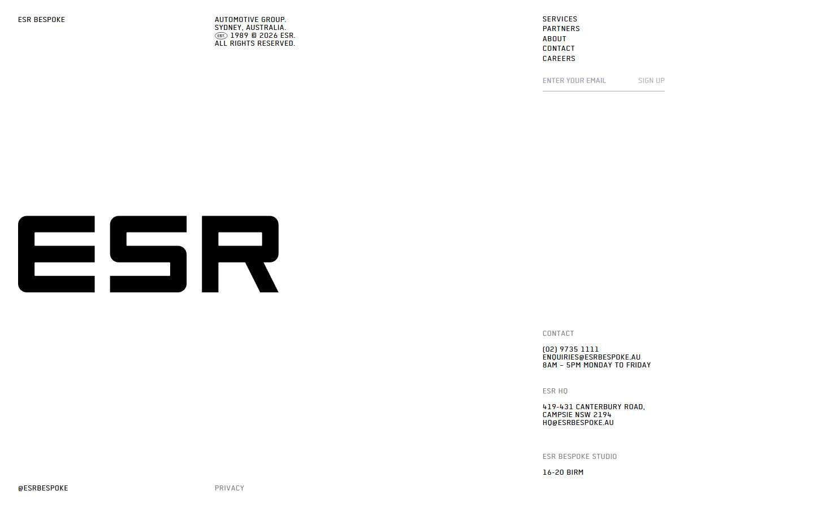

**Cambios vs anterior**
- cambio sutil de composición

**Fondo:** `rgb(255, 255, 255)`

**Figuras / media**
- **g** (g) opacity=1 · `matrix(1, 0, 0, 1, 0, -106)`
- **g** (g) opacity=1 · `matrix(1, 0, 0, 1, 0, -106)`
- **g** (g) opacity=1 · `matrix(1, 0, 0, 1, 0, -106)`

**Texto visible**
- “Contact” · 14px __headingFont_a39ca7
- “(02) 9735 1111enquiries@esrbespoke.au8am – 5pm Monday to Friday” · 14px __headingFont_a39ca7
- “ESR HQ” · 14px __headingFont_a39ca7
- “419-431 Canterbury Road, Campsie NSW 2194Hq@esrbespoke.au” · 14px __headingFont_a39ca7
- “ESR Bespoke Studio” · 14px __headingFont_a39ca7
- “16-20 Birmingham Street, Alexandria NSW 2015Studio@esrbespoke.au” · 14px __headingFont_a39ca7

**Sticky:** div, div, curtain

## Anotación IA

_Sin `GEMINI_API_KEY` / `GOOGLE_API_KEY` — solo captura mecánica._

## Port a SCROLLLAB

1. Smooth scroll → `SmoothScrollProvider` (Lenis)
2. Cada beat → primitivo del cookbook (`docs/motion-cookbook.md`) + sección en `src/components/sections/apex/`
3. Copy genérico (Headline N / Link N / lorem)
4. Actualizar [[Template reference index]] + mapa del SKU

## Gaps (llenar a mano tras mirar)

- [ ] Hero
- [ ] Sección firma (la más difícil)
- [ ] Footer
