---
tags:
  - scrolllab
  - reference-analysis
  - datum
aliases:
  - DATUM analysis
  - analyze datum
analyzed: 2026-10-19
source: https://santalarch.com
beats: 24
---

# DATUM — análisis de referencia

Generado por `scripts/analyze-reference.mjs` el 2026-10-19.

**URL:** https://santalarch.com  
**SKU sugerido:** `datum`  
**Title:** Santalarch  
**Beats:** 24 (muestreo adaptativo; solo cambios) · maxScroll=16461px

## Librerías detectadas

- `lenis`
- `swiper`
- `react`

### Scripts (muestra)

- `https://www.googletagmanager.com/gtag/js?id=G-TDYW18124Q`
- `https://santalarch.com/_nuxt/DrgmgFce.js`

### Fonts cargadas

- —

`html.class`: ``

## Técnicas inferidas

- Smooth scroll: Lenis
- Sticky/fixed nodes: preloader, Cookie consent, header, main-lines, div, cubes-bg, cubes-target, cubes-content-wrap, cubes-nav
- Beats significativos: 24 (solo cambios de firma)

## Capas Framer (`data-framer-name`)

- (no Framer names)

## Headings

| Tag | Texto | Font | Size |
|---|---|---|---|
| H2 | Bold | Helvetica | 98px |
| H2 | Confident | Helvetica | 98px |
| H2 | Quiet | Helvetica | 98px |
| H2 | Our Featured Projects | Helvetica | 10px |
| H2 | wedo | Helvetica | 234px |

## Beats (fondo / figura / texto)

### Beat 0 — 0% (y=0)

**Cambios vs anterior**
- beat inicial

**Fondo:** `rgba(0, 0, 0, 0)`

**Figuras / media**
- —

**Texto visible**
- —

**Sticky:** preloader, Cookie consent, header, main-lines, div, div, cubes-bg

### Beat 1 — 3% (y=514)

**Cambios vs anterior**
- sticky entra: cubes-target

**Fondo:** `rgba(0, 0, 0, 0)`

**Figuras / media**
- —

**Texto visible**
- —

**Sticky:** preloader, Cookie consent, header, main-lines, div, div, cubes-bg, cubes-target, div

### Beat 2 — 6% (y=1029)

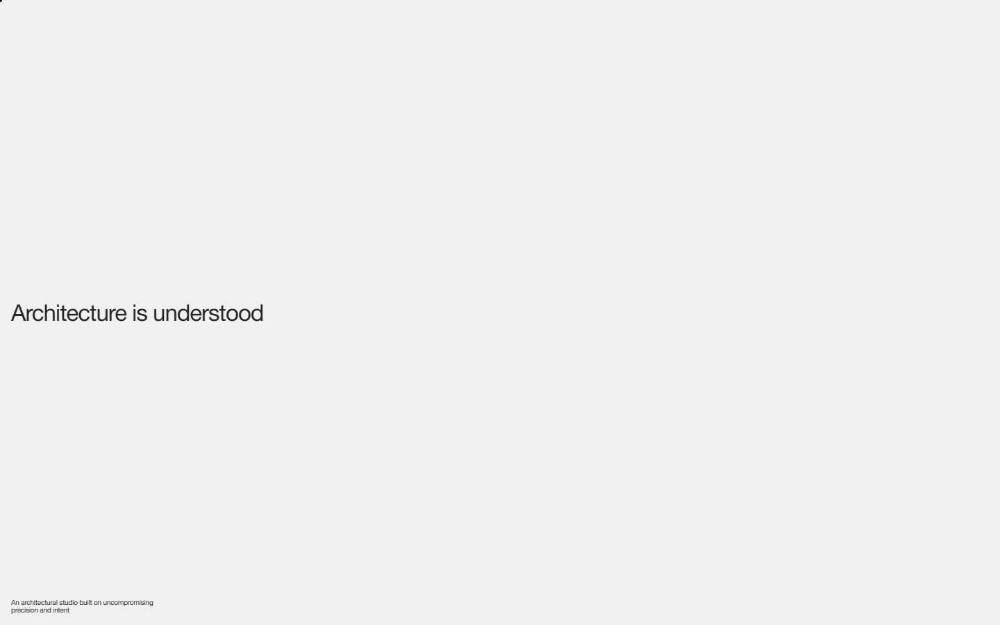

**Cambios vs anterior**
- sticky entra: cubes-content-wrap

**Fondo:** `rgba(0, 0, 0, 0)`

**Figuras / media**
- —

**Texto visible**
- —

**Sticky:** preloader, Cookie consent, header, main-lines, div, div, cubes-bg, cubes-target, div, cubes-content-wrap

### Beat 3 — 9% (y=1543)

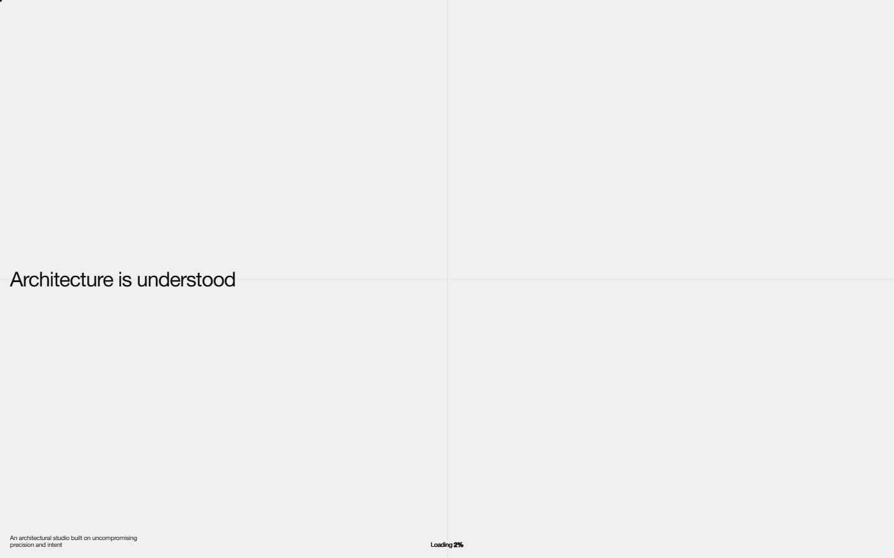

**Cambios vs anterior**
- sticky sale: Cookie consent
- figura entra: div (div)
- texto aparece: “layer”
- texto aparece: “by”
- texto aparece: “ArchitectureShapes Perception”

**Fondo:** `rgba(0, 0, 0, 0)`

**Figuras / media**
- **div** (div) opacity=1 · `matrix(1, 0, 0, 1, 0, -907)`

**Texto visible**
- “layer” · 33px Helvetica
- “by” · 33px Helvetica
- “layer” · 33px Helvetica
- “ArchitectureShapes Perception” · 98px Helvetica

**Sticky:** preloader, header, main-lines, div, div, cubes-bg, cubes-target, div, cubes-content-wrap

### Beat 4 — 13% (y=2058)

**Cambios vs anterior**
- sticky entra: cubes-nav
- figura mueve: div opacity 1→1 t=matrix(1, 0, 0, 1, -587.738, 0)

**Fondo:** `rgba(0, 0, 0, 0)`

**Figuras / media**
- **div** (div) opacity=1 · `matrix(1, 0, 0, 1, 0, -907)`
- **div** (div) opacity=1 · `matrix(1, 0, 0, 1, -587.738, 0)`

**Texto visible**
- “layer” · 33px Helvetica
- “by” · 33px Helvetica
- “layer” · 33px Helvetica
- “ArchitectureShapes Perception” · 98px Helvetica

**Sticky:** preloader, header, main-lines, div, div, cubes-bg, cubes-target, div, cubes-content-wrap, cubes-nav

### Beat 5 — 16% (y=2572)

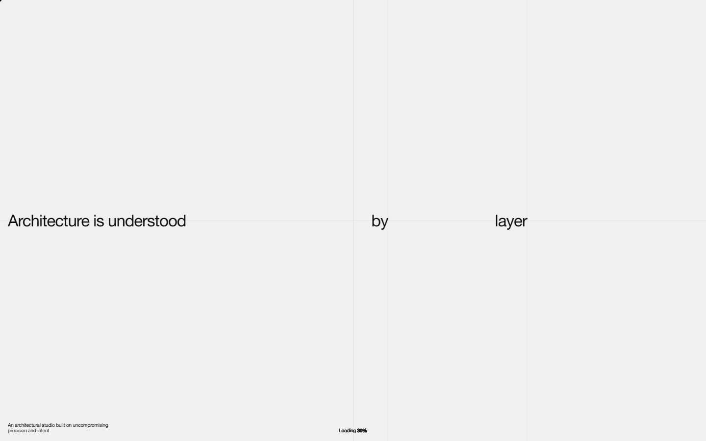

**Cambios vs anterior**
- figura mueve: div opacity 1→1 t=matrix(1, 0, 0, 1, 0, -907)
- figura mueve: div opacity 1→1 t=matrix(1, 0, 0, 1, -215.492, 0)
- figura mueve: div opacity 1→1 t=matrix(1, 0, 0, 1, -489.883, 0)
- figura mueve: div opacity 1→1 t=matrix(1, 0, 0, 1, -331.083, 0)
- texto sale: “ArchitectureShapes Perception”

**Fondo:** `rgba(0, 0, 0, 0)`

**Figuras / media**
- **div** (div) opacity=1 · `matrix(1, 0, 0, 1, 0, -907)`
- **div** (div) opacity=1 · `matrix(1, 0, 0, 1, -215.492, 0)`
- **div** (div) opacity=1 · `matrix(1, 0, 0, 1, -489.883, 0)`
- **div** (div) opacity=1 · `matrix(1, 0, 0, 1, -331.083, 0)`

**Texto visible**
- “layer” · 33px Helvetica
- “by” · 33px Helvetica
- “layer” · 33px Helvetica

**Sticky:** preloader, header, main-lines, div, div, cubes-bg, cubes-target, div, cubes-content-wrap, cubes-nav

### Beat 6 — 19% (y=3086)

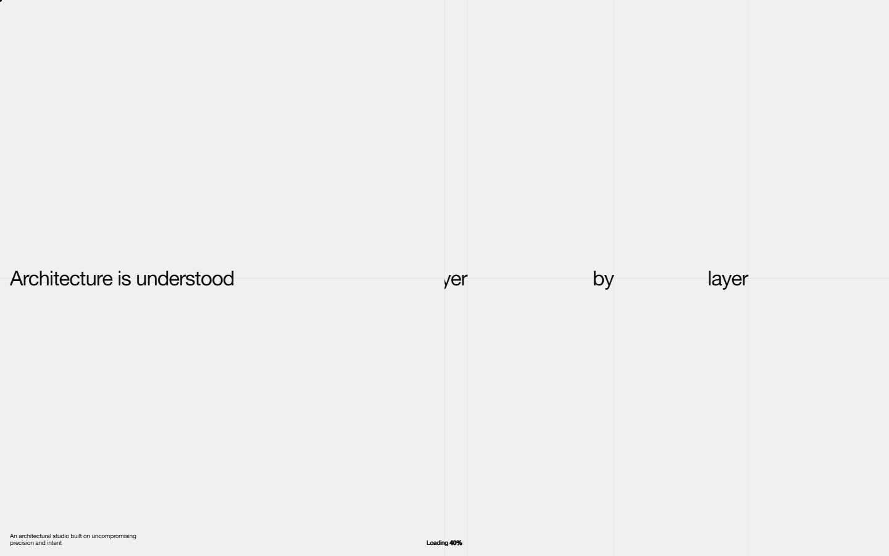

**Cambios vs anterior**
- figura mueve: div opacity 1→1 t=matrix(1, 0, 0, 1, -60.6165, 0)
- figura mueve: div opacity 1→1 t=matrix(1, 0, 0, 1, -104.634, 0)
- figura mueve: div opacity 1→1 t=matrix(1, 0, 0, 1, -171.263, 0)
- figura entra: span (span)
- figura entra: span (span)

**Fondo:** `rgba(0, 0, 0, 0)`

**Figuras / media**
- **div** (div) opacity=1 · `matrix(1, 0, 0, 1, -60.6165, 0)`
- **div** (div) opacity=1 · `matrix(1, 0, 0, 1, -104.634, 0)`
- **div** (div) opacity=1 · `matrix(1, 0, 0, 1, -171.263, 0)`
- **span** (span) opacity=1 · `matrix(1, 0, 0, 1, 235.777, 0)`
- **span** (span) opacity=1 · `matrix(1, 0, 0, 1, 430.617, 0)`

**Texto visible**
- “layer” · 33px Helvetica
- “by” · 33px Helvetica
- “layer” · 33px Helvetica

**Sticky:** preloader, header, main-lines, cubes-bg, cubes-target, div, cubes-content-wrap, cubes-nav, div

### Beat 7 — 22% (y=3601)

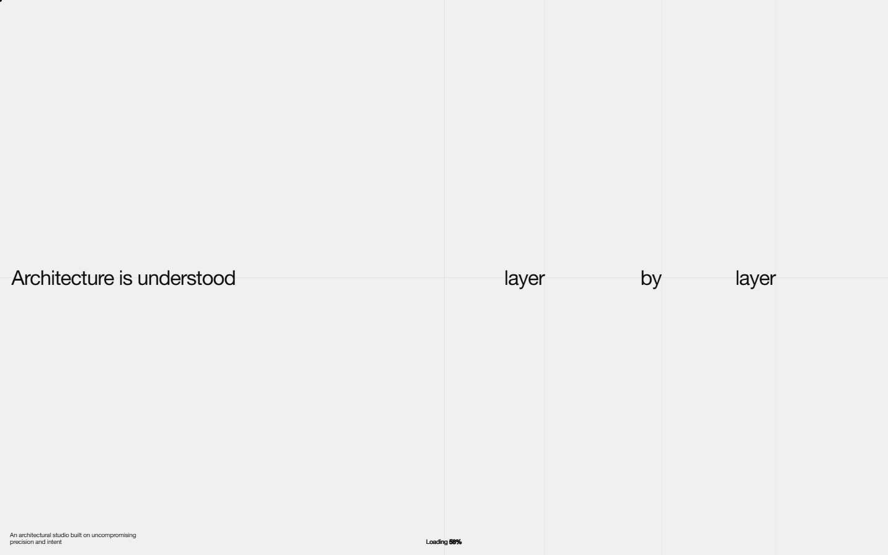

**Cambios vs anterior**
- sticky sale: cubes-content-wrap
- sticky sale: cubes-nav
- figura mueve: div opacity 1→1 t=matrix(1, 0, 0, 1, -40.1956, 0)
- figura mueve: div opacity 1→1 t=matrix(1, 0, 0, 1, -20.3556, 0)
- figura mueve: div opacity 1→1 t=matrix(1, 0, 0, 1, -9.1327, 0)
- figura mueve: span opacity 1→1 t=matrix(1, 0, 0, 1, 95.8046, 0)
- figura mueve: span opacity 1→1 t=matrix(1, 0, 0, 1, 0, 0)
- figura mueve: span opacity 1→1 t=matrix(1, 0, 0, 1, 19.2869, 0)
- figura mueve: span opacity 1→1 t=matrix(1, 0, 0, 1, 230.562, 0)

**Fondo:** `rgba(0, 0, 0, 0)`

**Figuras / media**
- **div** (div) opacity=1 · `matrix(1, 0, 0, 1, -40.1956, 0)`
- **div** (div) opacity=1 · `matrix(1, 0, 0, 1, -20.3556, 0)`
- **div** (div) opacity=1 · `matrix(1, 0, 0, 1, -9.1327, 0)`
- **span** (span) opacity=1 · `matrix(1, 0, 0, 1, 95.8046, 0)`
- **span** (span) opacity=1 · `matrix(1, 0, 0, 1, 0, 0)`
- **span** (span) opacity=1 · `matrix(1, 0, 0, 1, 19.2869, 0)`

**Texto visible**
- “layer” · 33px Helvetica
- “by” · 33px Helvetica
- “layer” · 33px Helvetica

**Sticky:** preloader, header, main-lines, cubes-bg, cubes-target, div, div, div

### Beat 8 — 25% (y=4115)

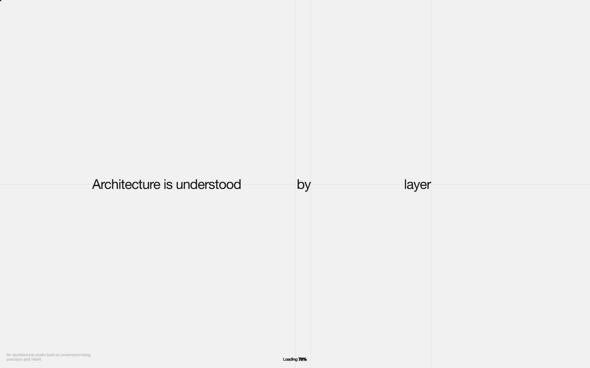

**Cambios vs anterior**
- sticky entra: cubes-content-wrap
- sticky entra: cubes-nav
- figura entra: canvas (canvas)
- figura mueve: div opacity 1→1 t=matrix(1, 0, 0, 1, 0, 0)
- figura mueve: div opacity 1→1 t=matrix(1, 0, 0, 1, 0, 0)
- figura mueve: div opacity 1→1 t=matrix(1, 0, 0, 1, -138.743, 0)
- figura mueve: div opacity 1→1 t=matrix(1, 0, 0, 1, -82.9015, 0)
- figura mueve: div opacity 1→1 t=matrix(1, 0, 0, 1, -46.6754, 0)
- figura mueve: span opacity 1→1 t=matrix(1, 0, 0, 1, 46.6754, 0)

**Fondo:** `rgba(0, 0, 0, 0)`

**Figuras / media**
- **canvas** (canvas) opacity=1
- **div** (div) opacity=1 · `matrix(1, 0, 0, 1, 0, 0)`
- **div** (div) opacity=1 · `matrix(1, 0, 0, 1, 0, 0)`
- **div** (div) opacity=1 · `matrix(1, 0, 0, 1, -138.743, 0)`
- **div** (div) opacity=1 · `matrix(1, 0, 0, 1, -82.9015, 0)`
- **div** (div) opacity=1 · `matrix(1, 0, 0, 1, -46.6754, 0)`

**Texto visible**
- “layer” · 33px Helvetica
- “by” · 33px Helvetica
- “layer” · 33px Helvetica

**Sticky:** preloader, header, main-lines, cubes-bg, cubes-target, div, cubes-content-wrap, cubes-nav

### Beat 9 — 28% (y=4630)

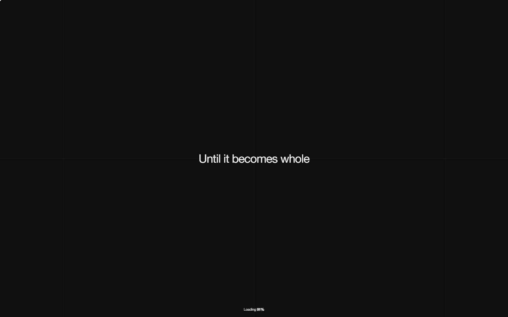

**Cambios vs anterior**
- figura mueve: div opacity 1→1 t=matrix(1, 0, 0, 1, 0, 0)
- figura mueve: div opacity 1→1 t=matrix(1, 0, 0, 1, 0, 0)
- figura mueve: div opacity 1→1 t=matrix(1, 0, 0, 1, -720, 0)
- figura mueve: div opacity 1→1 t=matrix(1, 0, 0, 1, -720, 0)
- figura mueve: div opacity 1→1 t=matrix(1, 0, 0, 1, -720, 0)
- figura mueve: span opacity 1→1 t=matrix(1, 0, 0, 1, 720, 0)
- texto aparece: “Until it becomes whole”

**Fondo:** `rgba(0, 0, 0, 0)`

**Figuras / media**
- **canvas** (canvas) opacity=1
- **div** (div) opacity=1 · `matrix(1, 0, 0, 1, 0, 0)`
- **div** (div) opacity=1 · `matrix(1, 0, 0, 1, 0, 0)`
- **div** (div) opacity=1 · `matrix(1, 0, 0, 1, -720, 0)`
- **div** (div) opacity=1 · `matrix(1, 0, 0, 1, -720, 0)`
- **div** (div) opacity=1 · `matrix(1, 0, 0, 1, -720, 0)`

**Texto visible**
- “layer” · 33px Helvetica
- “by” · 33px Helvetica
- “layer” · 33px Helvetica
- “Until it becomes whole” · 33px Helvetica

**Sticky:** preloader, header, main-lines, cubes-bg, cubes-target, div, cubes-content-wrap, cubes-nav

### Beat 10 — 38% (y=6173)

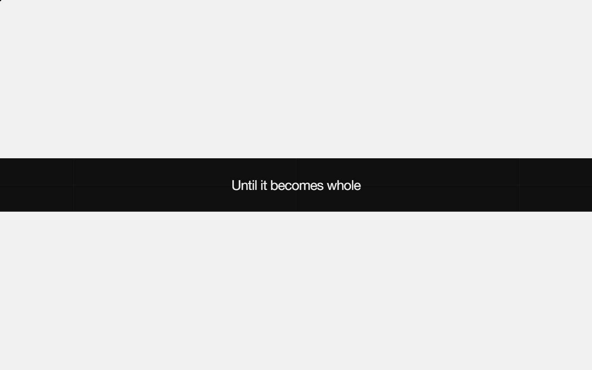

**Cambios vs anterior**
- figura mueve: div opacity 1→1 t=matrix(1, 0, 0, 1, 0, 0)
- figura mueve: div opacity 1→1 t=matrix(1, 0, 0, 1, 0, 0)
- figura mueve: div opacity 1→1 t=matrix(1, 0, 0, 0.6085, 0, 0)
- figura mueve: div opacity 1→1 t=matrix(1, 0, 0, 0.6085, 0, 0)

**Fondo:** `rgba(0, 0, 0, 0)`

**Figuras / media**
- **canvas** (canvas) opacity=1
- **div** (div) opacity=1 · `matrix(1, 0, 0, 1, 0, 0)`
- **div** (div) opacity=1 · `matrix(1, 0, 0, 1, 0, 0)`
- **div** (div) opacity=1 · `matrix(1, 0, 0, 1, -720, 0)`
- **div** (div) opacity=1 · `matrix(1, 0, 0, 1, -720, 0)`
- **div** (div) opacity=1 · `matrix(1, 0, 0, 1, -720, 0)`

**Texto visible**
- “layer” · 33px Helvetica
- “by” · 33px Helvetica
- “layer” · 33px Helvetica
- “Until it becomes whole” · 33px Helvetica

**Sticky:** preloader, header, main-lines, cubes-bg, cubes-target, div, cubes-content-wrap, cubes-nav

### Beat 11 — 41% (y=6687)

**Cambios vs anterior**
- figura mueve: div opacity 1→1 t=matrix(1, 0, 0, 1, 0, 0)
- figura mueve: div opacity 1→1 t=matrix(1, 0, 0, 1, 0, 0)
- figura mueve: div opacity 1→1 t=matrix(1, 0, 0, 1, -720, 0)
- figura mueve: div opacity 1→1 t=matrix(1, 0, 0, 1, -720, 0)
- figura mueve: div opacity 1→1 t=matrix(1, 0, 0, 1, -720, 0)
- figura mueve: div opacity 1→1 t=matrix(1, 0, 0, 0.9879, 0, 0)
- figura mueve: div opacity 1→1 t=matrix(1, 0, 0, 0.9879, 0, 0)
- figura entra: cubes-video (canvas)

**Fondo:** `rgba(0, 0, 0, 0)`

**Figuras / media**
- **canvas** (canvas) opacity=1
- **div** (div) opacity=1 · `matrix(1, 0, 0, 1, 0, 0)`
- **div** (div) opacity=1 · `matrix(1, 0, 0, 1, 0, 0)`
- **div** (div) opacity=1 · `matrix(1, 0, 0, 1, -720, 0)`
- **div** (div) opacity=1 · `matrix(1, 0, 0, 1, -720, 0)`
- **div** (div) opacity=1 · `matrix(1, 0, 0, 1, -720, 0)`

**Texto visible**
- “layer” · 33px Helvetica
- “by” · 33px Helvetica
- “layer” · 33px Helvetica
- “Until it becomes whole” · 33px Helvetica

**Sticky:** preloader, header, main-lines, cubes-bg, cubes-target, div, cubes-content-wrap, cubes-nav

### Beat 12 — 44% (y=7202)

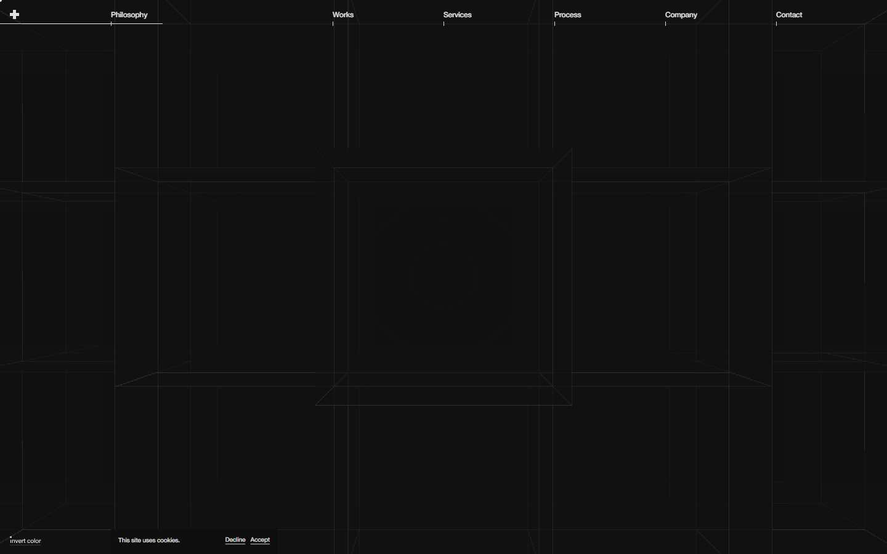

**Cambios vs anterior**
- figura mueve: div opacity 1→1 t=matrix(1, 0, 0, 1, 0, 0)
- figura mueve: div opacity 1→1 t=matrix(1, 0, 0, 1, 0, 0)
- figura mueve: div opacity 1→1 t=matrix(1, 0, 0, 1, -720, 0)
- figura mueve: div opacity 1→1 t=matrix(1, 0, 0, 1, -720, 0)
- figura mueve: div opacity 1→1 t=matrix(1, 0, 0, 1, -720, 0)
- figura mueve: div opacity 1→1 t=matrix(1, 0, 0, 1, 0, 0)
- figura mueve: div opacity 1→1 t=matrix(1, 0, 0, 1, 0, 0)

**Fondo:** `rgba(0, 0, 0, 0)`

**Figuras / media**
- **canvas** (canvas) opacity=1
- **div** (div) opacity=1 · `matrix(1, 0, 0, 1, 0, 0)`
- **div** (div) opacity=1 · `matrix(1, 0, 0, 1, 0, 0)`
- **div** (div) opacity=1 · `matrix(1, 0, 0, 1, -720, 0)`
- **div** (div) opacity=1 · `matrix(1, 0, 0, 1, -720, 0)`
- **div** (div) opacity=1 · `matrix(1, 0, 0, 1, -720, 0)`

**Texto visible**
- “layer” · 33px Helvetica
- “by” · 33px Helvetica
- “layer” · 33px Helvetica
- “Until it becomes whole” · 33px Helvetica

**Sticky:** preloader, header, main-lines, cubes-bg, cubes-target, div, cubes-content-wrap, cubes-nav

### Beat 13 — 47% (y=7716)

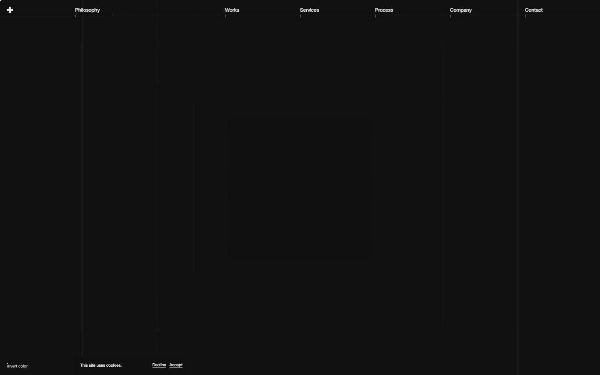

**Cambios vs anterior**
- sticky entra: Cookie consent
- sticky sale: preloader
- figura entra: Cookie consent (aside)
- texto sale: “layer”
- texto sale: “by”
- texto sale: “Until it becomes whole”

**Fondo:** `rgba(0, 0, 0, 0)`

**Figuras / media**
- **canvas** (canvas) opacity=1
- **div** (div) opacity=1 · `matrix(1, 0, 0, 1, 0, 0)`
- **div** (div) opacity=1 · `matrix(1, 0, 0, 1, 0, 0)`
- **cubes-video** (canvas) opacity=1
- **Cookie consent** (aside) opacity=1 · `matrix(1, 0, 0, 1, 0, 0)`

**Texto visible**
- —

**Sticky:** Cookie consent, header, main-lines, cubes-bg, cubes-target, div, cubes-content-wrap, cubes-nav

### Beat 14 — 50% (y=8231)

**Cambios vs anterior**
- cambio sutil de composición

**Fondo:** `rgba(0, 0, 0, 0)`

**Figuras / media**
- **canvas** (canvas) opacity=1
- **cubes-video** (canvas) opacity=1
- **div** (div) opacity=1 · `matrix(1, 0, 0, 1, 0, 0)`
- **div** (div) opacity=1 · `matrix(1, 0, 0, 1, 0, 0)`
- **Cookie consent** (aside) opacity=1 · `matrix(1, 0, 0, 1, 0, 0)`

**Texto visible**
- —

**Sticky:** Cookie consent, header, main-lines, cubes-bg, cubes-target, div, cubes-content-wrap, cubes-nav

### Beat 15 — 53% (y=8745)

**Cambios vs anterior**
- cambio sutil de composición

**Fondo:** `rgba(0, 0, 0, 0)`

**Figuras / media**
- **canvas** (canvas) opacity=1
- **cubes-video** (canvas) opacity=1
- **div** (div) opacity=1 · `matrix(1, 0, 0, 1, 0, 0)`
- **div** (div) opacity=1 · `matrix(1, 0, 0, 1, 0, 0)`
- **Cookie consent** (aside) opacity=1 · `matrix(1, 0, 0, 1, 0, 0)`

**Texto visible**
- —

**Sticky:** Cookie consent, header, main-lines, cubes-bg, cubes-target, div, cubes-content-wrap, cubes-nav

### Beat 16 — 59% (y=9774)

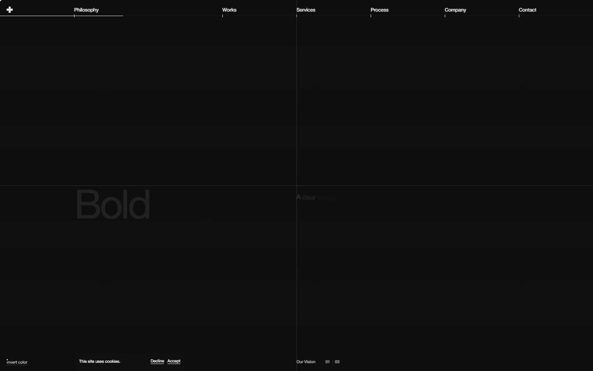

**Cambios vs anterior**
- cambio sutil de composición

**Fondo:** `rgba(0, 0, 0, 0)`

**Figuras / media**
- **canvas** (canvas) opacity=1
- **cubes-video** (canvas) opacity=1
- **div** (div) opacity=1 · `matrix(1, 0, 0, 1, 0, 0)`
- **div** (div) opacity=1 · `matrix(1, 0, 0, 1, 0, 0)`
- **Cookie consent** (aside) opacity=1 · `matrix(1, 0, 0, 1, 0, 0)`

**Texto visible**
- —

**Sticky:** Cookie consent, header, main-lines, cubes-bg, cubes-target, div, cubes-content-wrap, cubes-nav

### Beat 17 — 63% (y=10288)

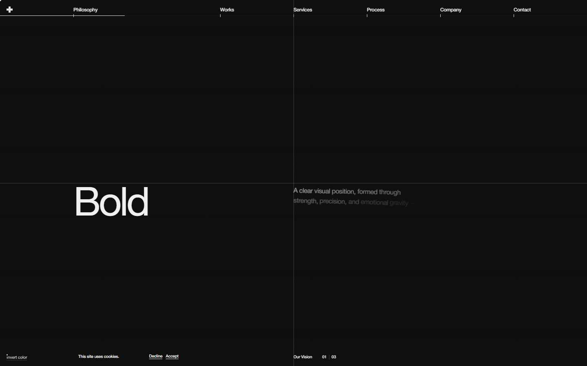

**Cambios vs anterior**
- texto aparece: “Bold”

**Fondo:** `rgba(0, 0, 0, 0)`

**Figuras / media**
- **canvas** (canvas) opacity=1
- **cubes-video** (canvas) opacity=1
- **div** (div) opacity=1 · `matrix(1, 0, 0, 1, 0, 0)`
- **div** (div) opacity=1 · `matrix(1, 0, 0, 1, 0, 0)`
- **Cookie consent** (aside) opacity=1 · `matrix(1, 0, 0, 1, 0, 0)`

**Texto visible**
- “Bold” · 98px Helvetica

**Sticky:** Cookie consent, header, main-lines, cubes-bg, cubes-target, div, cubes-content-wrap, cubes-nav

### Beat 18 — 72% (y=11831)

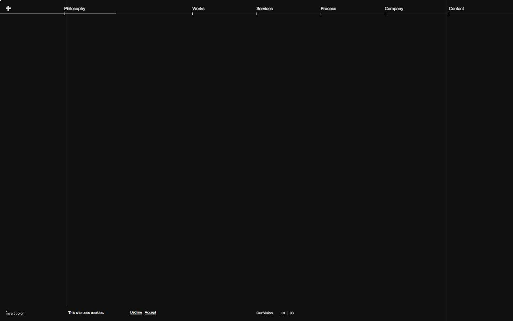

**Cambios vs anterior**
- texto sale: “Bold”

**Fondo:** `rgba(0, 0, 0, 0)`

**Figuras / media**
- **canvas** (canvas) opacity=1
- **cubes-video** (canvas) opacity=1
- **div** (div) opacity=1 · `matrix(1, 0, 0, 1, 0, 0)`
- **div** (div) opacity=1 · `matrix(1, 0, 0, 1, 0, 0)`
- **Cookie consent** (aside) opacity=1 · `matrix(1, 0, 0, 1, 0, 0)`

**Texto visible**
- —

**Sticky:** Cookie consent, header, main-lines, cubes-bg, cubes-target, div, cubes-content-wrap, cubes-nav

### Beat 19 — 75% (y=12346)

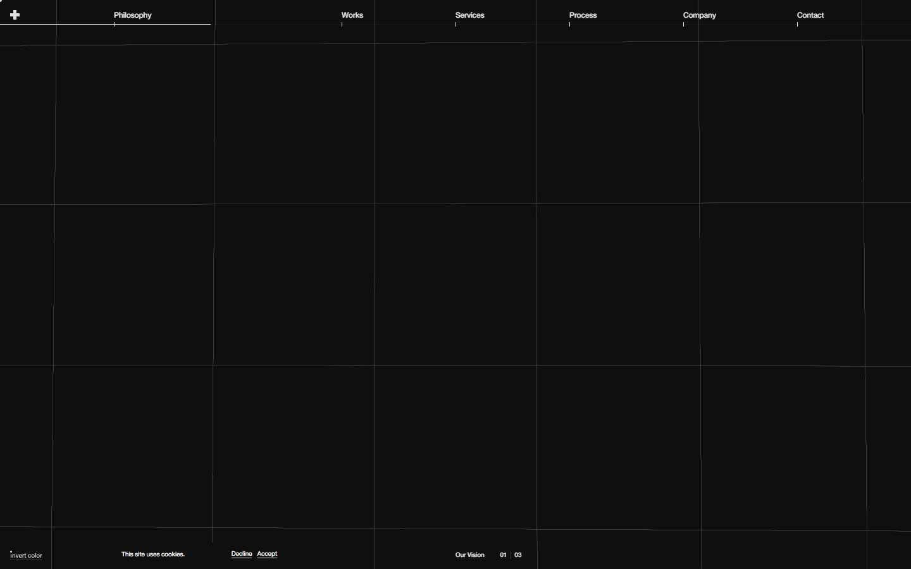

**Cambios vs anterior**
- cambio sutil de composición

**Fondo:** `rgba(0, 0, 0, 0)`

**Figuras / media**
- **canvas** (canvas) opacity=1
- **cubes-video** (canvas) opacity=1
- **div** (div) opacity=1 · `matrix(1, 0, 0, 1, 0, 0)`
- **div** (div) opacity=1 · `matrix(1, 0, 0, 1, 0, 0)`
- **Cookie consent** (aside) opacity=1 · `matrix(1, 0, 0, 1, 0, 0)`

**Texto visible**
- —

**Sticky:** Cookie consent, header, main-lines, cubes-bg, cubes-target, div, cubes-content-wrap, cubes-nav

### Beat 20 — 78% (y=12860)

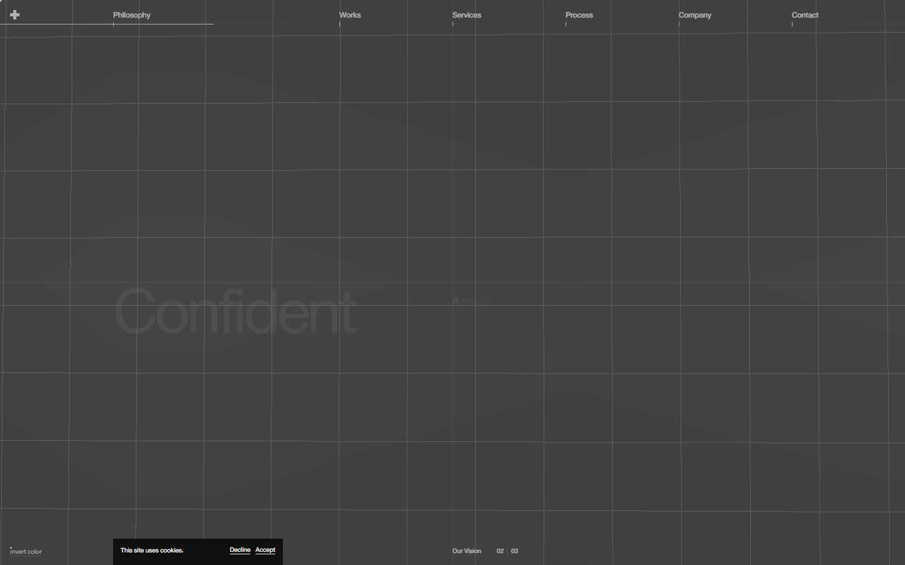

**Cambios vs anterior**
- texto aparece: “A precise system of decisions, where every detail ”

**Fondo:** `rgba(0, 0, 0, 0)`

**Figuras / media**
- **canvas** (canvas) opacity=1
- **cubes-video** (canvas) opacity=1
- **div** (div) opacity=1 · `matrix(1, 0, 0, 1, 0, 0)`
- **div** (div) opacity=1 · `matrix(1, 0, 0, 1, 0, 0)`
- **Cookie consent** (aside) opacity=1 · `matrix(1, 0, 0, 1, 0, 0)`

**Texto visible**
- “A precise system of decisions, where every detail is resolved to create reliabil” · 16px Helvetica

**Sticky:** Cookie consent, header, main-lines, cubes-bg, cubes-target, div, cubes-content-wrap, cubes-nav

### Beat 21 — 81% (y=13375)

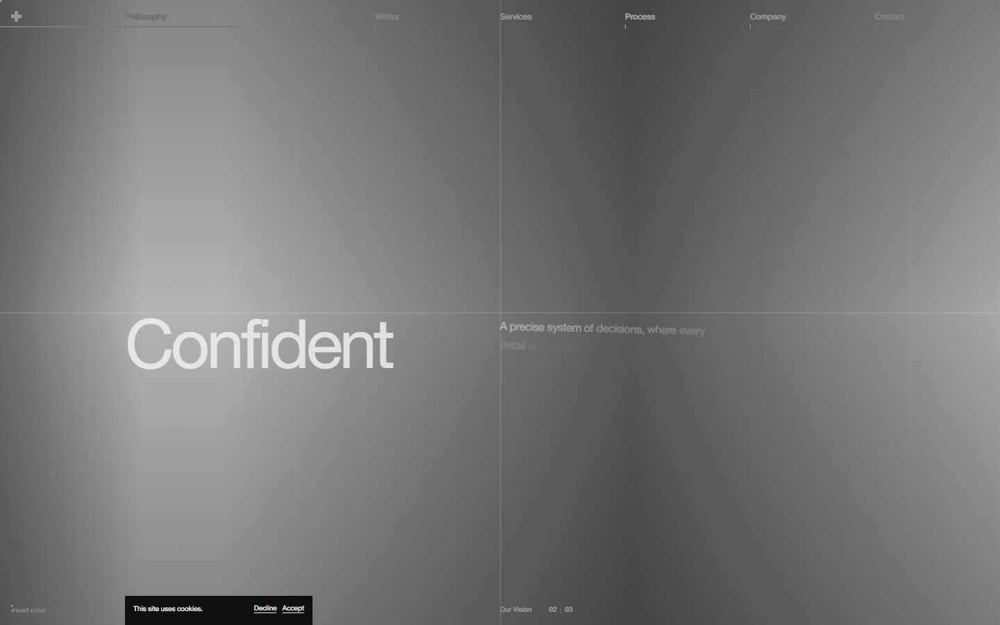

**Cambios vs anterior**
- texto aparece: “Confident”

**Fondo:** `rgba(0, 0, 0, 0)`

**Figuras / media**
- **canvas** (canvas) opacity=1
- **cubes-video** (canvas) opacity=1
- **div** (div) opacity=1 · `matrix(1, 0, 0, 1, 0, 0)`
- **div** (div) opacity=1 · `matrix(1, 0, 0, 1, 0, 0)`
- **Cookie consent** (aside) opacity=1 · `matrix(1, 0, 0, 1, 0, 0)`

**Texto visible**
- “Confident” · 98px Helvetica
- “A precise system of decisions, where every detail is resolved to create reliabil” · 16px Helvetica

**Sticky:** Cookie consent, header, main-lines, cubes-bg, cubes-target, div, cubes-content-wrap, cubes-nav

### Beat 22 — 91% (y=14918)

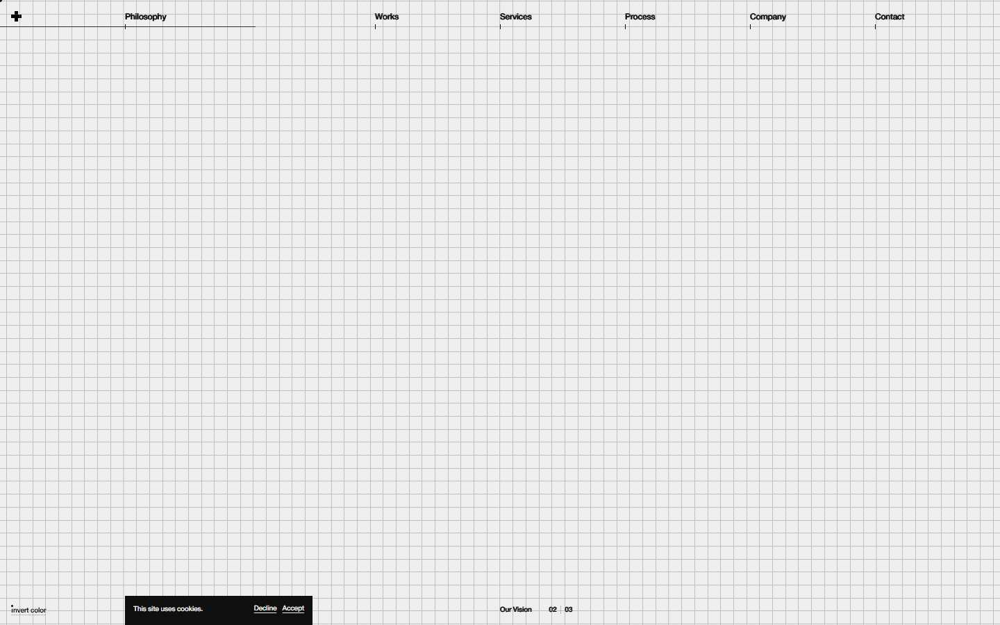

**Cambios vs anterior**
- texto sale: “Confident”
- texto sale: “A precise system of decisions, where every detail ”

**Fondo:** `rgba(0, 0, 0, 0)`

**Figuras / media**
- **canvas** (canvas) opacity=1
- **cubes-video** (canvas) opacity=1
- **div** (div) opacity=1 · `matrix(1, 0, 0, 1, 0, 0)`
- **div** (div) opacity=1 · `matrix(1, 0, 0, 1, 0, 0)`
- **Cookie consent** (aside) opacity=1 · `matrix(1, 0, 0, 1, 0, 0)`

**Texto visible**
- —

**Sticky:** Cookie consent, header, main-lines, cubes-bg, cubes-target, div, cubes-content-wrap, cubes-nav

### Beat 23 — 100% (y=16461)

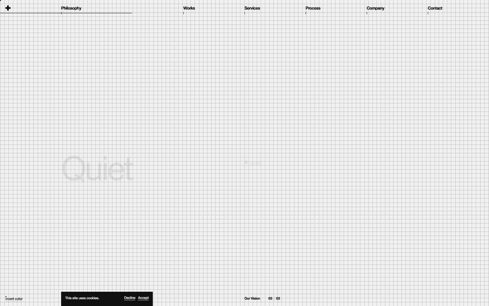

**Cambios vs anterior**
- texto aparece: “A quiet presence, formed through restraint and bal”

**Fondo:** `rgba(0, 0, 0, 0)`

**Figuras / media**
- **canvas** (canvas) opacity=1
- **cubes-video** (canvas) opacity=1
- **div** (div) opacity=1 · `matrix(1, 0, 0, 1, 0, 0)`
- **div** (div) opacity=1 · `matrix(1, 0, 0, 1, 0, 0)`
- **Cookie consent** (aside) opacity=1 · `matrix(1, 0, 0, 1, 0, 0)`

**Texto visible**
- “A quiet presence, formed through restraint and balance — architecture that does ” · 16px Helvetica

**Sticky:** Cookie consent, header, main-lines, cubes-bg, cubes-target, div, cubes-content-wrap, cubes-nav

## Anotación IA

_Sin `GEMINI_API_KEY` / `GOOGLE_API_KEY` — solo captura mecánica._

## Port a SCROLLLAB

1. Smooth scroll → `SmoothScrollProvider` (Lenis)
2. Cada beat → primitivo del cookbook (`docs/motion-cookbook.md`) + sección en `src/components/sections/datum/`
3. Copy de un negocio inventado (nunca el de la ref ni lorem; cada link a una sección) — `docs/template-copy.md`
4. Actualizar [[Template reference index]] + mapa del SKU

## Gaps (llenar a mano tras mirar)

- [ ] Hero
- [ ] Sección firma (la más difícil)
- [ ] Footer
